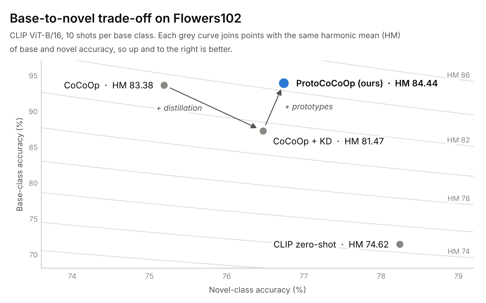
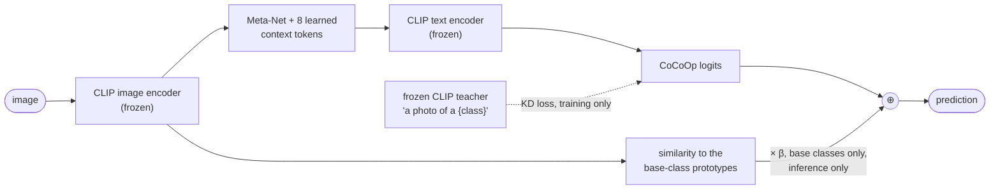

<h1 align="center">ProtoCoCoOp</h1>

<p align="center">
  <b>Few-shot adaptation of CLIP that keeps its zero-shot generalization.</b><br>
  Prompt learning (CoCoOp) + knowledge distillation from frozen CLIP + training-free visual prototypes.
</p>

<p align="center">
  <a href="paper/ProtoCoCoOp.pdf"></a>
  <a href="https://colab.research.google.com/github/giampyhatesyou/CLIP_Project-UniTn/blob/main/dl_project.ipynb"></a>
  
  
  
</p>

<p align="center">
  <picture>
    <source media="(prefers-color-scheme: dark)" srcset="assets/tradeoff_dark.png">
    
  </picture>
</p>

## TL;DR

- **84.44 harmonic mean** on the Flowers102 base-to-novel benchmark (10 shots per class, CLIP ViT-B/16): the best of the four configurations we compared, **+9.8 points over zero-shot CLIP** and **+1.1 over CoCoOp**.
- **Base accuracy back to CoCoOp level (93.85%) while keeping the novel-class gain of distillation.** The prototype residual adds 6.7 base points at inference time, with no extra training.
- **37K trainable parameters**, about 0.025% of CLIP. Both encoders stay frozen.
- Novel accuracy is still 1.5 points below zero-shot CLIP: the method narrows the generalization gap but does not close it. The [two-page report](paper/ProtoCoCoOp.pdf) discusses what the experiments show and what they do not.

## The problem

CLIP can recognize almost any category from a text prompt such as *"a photo of a {class}"*. With a few labeled images you can adapt it through **prompt learning**, which learns the prompt instead of writing it by hand. The catch is that prompts tuned on the classes you have data for (**base**) get worse on classes of the same task that you never trained on (**novel**). We want to gain on the first without losing on the second, so every method is scored by the **harmonic mean (HM)** of base and novel accuracy, which punishes any imbalance between the two.

## How it works

ProtoCoCoOp keeps [CoCoOp](https://arxiv.org/abs/2203.05557) as the backbone: 8 learnable context tokens plus a small Meta-Net that conditions them on each image. On top of it we add two components, neither of which adds trainable parameters:

1. **Knowledge distillation, during training.** The frozen CLIP model acts as a teacher. A KL term (α = 0.3, T = 2) keeps the student's predictions close to CLIP's zero-shot ones, so the learned prompts cannot drift too far from what makes CLIP generalize.
2. **Prototype residual, at inference.** Each base class gets a visual prototype: the mean CLIP embedding of its 10 training images plus 10 augmented views of each. At test time, the image's similarity to these prototypes is added to the base-class logits (β = 0.5). Novel classes are left untouched.



## Results

Flowers102, base-to-novel split (51 + 51 classes), 10 shots per base class, CLIP ViT-B/16. Test accuracy in %.

| Method | Base | Novel | HM |
| --- | ---: | ---: | ---: |
| CLIP zero-shot | 71.33 | **78.24** | 74.62 |
| CoCoOp | 93.57 | 75.19 | 83.38 |
| CoCoOp + KD | 87.18 | 76.47 | 81.47 |
| **ProtoCoCoOp (ours)** | **93.85** | 76.74 | **84.44** |

What the table shows:

- **Prompt learning trades novel accuracy for base accuracy.** CoCoOp gains 22.2 base points over zero-shot CLIP and loses 3.1 novel points.
- **Distillation on its own shifts the trade-off instead of improving it:** +1.3 novel, -6.4 base, lower HM.
- **Prototypes give the base accuracy back.** CoCoOp + KD and ProtoCoCoOp share the same training and differ only at inference, so the jump from 87.18 to 93.85 on base classes comes from the prototype residual.

Our zero-shot CLIP numbers (71.33 / 78.24) are close to those reported in the CoCoOp paper on the same split (72.08 / 77.80), which is a useful sanity check on the evaluation pipeline.

## Limitations and next steps

- **One run, one dataset.** Every number comes from a single seed (42) on Flowers102. The +1.06 HM gain over CoCoOp should be confirmed over several seeds and on the 11 datasets of the CoCoOp benchmark.
- **One ablation is missing.** The prototype-only configuration (`CURRENT_MODE = "proto"`) is implemented but not reported, so the results do not prove that distillation is needed in the final model.
- **Separate evaluation.** Base and novel classes are evaluated separately, as in the standard protocol. In a joint 102-way evaluation, the base-only residual would need calibration.
- **Novel class names.** The distillation term covers all 102 class names (never novel images or labels). Restricting it to base names would be the stricter protocol.

## Run it

The whole pipeline lives in one notebook, [`dl_project.ipynb`](dl_project.ipynb): data loading, the zero-shot baseline, the model, training, evaluation and plots. A CUDA GPU is recommended.

- **Colab:** click the badge above, switch the runtime to GPU and run all cells.
- **Locally:**

```bash
pip install -r requirements.txt jupyter
jupyter notebook dl_project.ipynb
```

Flowers102 is downloaded automatically by torchvision into `data/`. Checkpoints, logs and plots go to `results/`. To reproduce each row of the table, set `CURRENT_MODE` in section 5.3:

- `"standard"` for CoCoOp;
- `"kd"` for CoCoOp + KD;
- `"proto_kd"` for ProtoCoCoOp;
- `"proto"` for prototypes without KD.

## Repository

```
dl_project.ipynb        full pipeline: data, CLIP baseline, ProtoCoCoOp, training, evaluation
paper/ProtoCoCoOp.pdf   two-page report (LaTeX source and figure in paper/)
assets/                 README figures; make_figures.py redraws them from the reported numbers
requirements.txt
```

## Team

Andrea Giampietro, Marco Gandolfi and Stefano Camposilvan. Deep Learning course project, University of Trento, a.y. 2024/25.

## References

- Radford et al. *Learning Transferable Visual Models From Natural Language Supervision* (CLIP). ICML 2021.
- Zhou et al. *Learning to Prompt for Vision-Language Models* (CoOp). IJCV 2022.
- Zhou et al. *Conditional Prompt Learning for Vision-Language Models* (CoCoOp). CVPR 2022.
- Zhang et al. *Tip-Adapter: Training-free Adaption of CLIP for Few-shot Classification*. ECCV 2022.
- Hinton et al. *Distilling the Knowledge in a Neural Network*. arXiv 2015.
- Nilsback and Zisserman. *Automated Flower Classification over a Large Number of Classes* (Flowers102). ICVGIP 2008.
